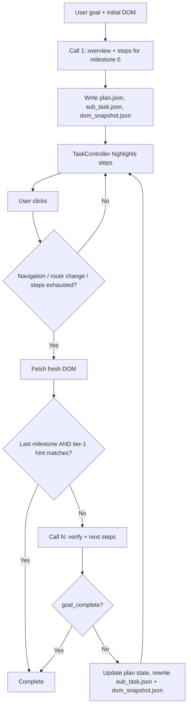

# Handoff: Milestone-Based Task Generation (API providers only)

## 1. Objective

Replace the current "flat step list per page + last completed step" continuation logic with a **persistent milestone plan**. The LLM produces an overview of milestones once, then on every navigation a **single combined API call** both verifies the current milestone and generates the highlight steps for the page.

Ollama is being removed. Only API providers (Gemini first) are in scope.

## 2. Hard constraints (do not violate)

1. **Do not change** the contracts of `Task`, `Step`, `TaskController`, or the `tasks/dom_snapshot.json` format. The Windows UIA path uses them.
2. `Step.from_dict` must keep receiving the same step JSON shape the generator emits today. Reuse the existing step schema in `core/ai_task_generator.py` verbatim; do not invent new step fields.
3. Milestone state lives **only in the orchestrator layer** (the code that currently owns the navigation callback and builds the continuation prompt). `TaskController` must never know about milestones.
4. UIA / non-browser platforms must keep working with no overview: treat them as a single implicit milestone equal to the user query.
5. Remove Ollama code paths and `OLLAMA_TIMEOUT_SECONDS`. Do not add `torch`, `sentence-transformers`, or any local model dependency.

## 3. Target flow



API calls: **one** at start, **one** per verification point. Never a separate verify call and generate call.

## 4. New state: `TaskPlan`

New module `core/task_plan.py`, persisted to `tasks/plan.json` after every mutation.

```json
{
  "original_goal": "string",
  "milestones": [
    {
      "id": 0,
      "goal": "Goal-level description, never element-level",
      "success_hint": {
        "url_contains": ["/checkout"],
        "text_contains": ["Order summary"]
      },
      "status": "pending | active | done",
      "attempts": 0
    }
  ],
  "current_index": 0,
  "replans": 0
}
```

Methods needed: `advance()`, `mark_attempt()`, `replace_remaining(new_milestones)`, `is_last()`, `current()`, `save()`, `load()`, `single_milestone(goal)` (factory for UIA / fallback).

Config constants (put in the existing config location): `MAX_ATTEMPTS_PER_MILESTONE = 3`, `MAX_REPLANS = 2`, `DOM_TEXT_MAX_CHARS` for the tier-1 text check.

## 5. Generator API (`core/ai_task_generator.py`)

Add two methods to the Gemini generator. Keep the existing `generate` working for the UIA path until it is migrated.

```python
def generate_plan_and_steps(self, query: str, url: str, dom: list) -> PlanResponse
def verify_and_generate(self, plan: TaskPlan, last_completed_step: str,
                        url: str, dom: list, heuristic_hint_matched: bool) -> VerifyResponse
```

Use Gemini structured output (`response_schema` with `response_mime_type="application/json"`). Keep schemas flat; Gemini supports only a subset of JSON Schema. `steps` items must use the **existing** step schema.

### 5.1 Call 1 response (`PlanResponse`)

```json
{
  "milestones": [
    {"goal": "...", "success_hint": {"url_contains": [], "text_contains": []}}
  ],
  "steps": [ /* existing step schema, for milestone 0 on THIS page only */ ]
}
```

### 5.2 Call N response (`VerifyResponse`)

```json
{
  "milestone_met": true,
  "goal_complete": false,
  "reason": "short string for logs",
  "revised_remaining_milestones": null,
  "steps": [ /* existing step schema, for whichever milestone is active AFTER this verdict */ ]
}
```

Semantics:
- `milestone_met=true` → orchestrator advances index; `steps` target the **next** milestone.
- `milestone_met=false` → `steps` continue the **current** milestone on this page.
- `goal_complete=true` → `steps` may be empty; orchestrator finishes.
- `revised_remaining_milestones` non-null → the model says the plan no longer fits this page; orchestrator calls `replace_remaining` (counts against `MAX_REPLANS`).

### 5.3 Prompt requirements

**Call 1 system instructions**
- Produce 2 to 6 milestones. Each is a goal-level outcome ("open the product page", "reach payment"), never a click or element reference. The model has only seen one page, so milestones beyond the first are guesses.
- Provide `success_hint` per milestone: URL substrings and/or visible text likely present when it is done. Leave arrays empty when unsure; do not fabricate.
- Generate steps only for milestone 0 using elements present in the supplied DOM.
- Simple tasks that finish on one page get exactly one milestone.

**Call N system instructions**
- Inputs: original goal, full milestone list with statuses, current milestone, last completed step, current URL, fresh DOM, and `heuristic_hint_matched` (bool, evidence only).
- First decide whether the current milestone is met based on the URL and DOM. Then generate steps for the resulting active milestone using only elements in the supplied DOM.
- Do not repeat completed actions. Do not navigate backward. If no element on this page can advance the goal, return empty `steps` with `milestone_met=false` and explain in `reason`.
- Return `revised_remaining_milestones` only if the remaining plan clearly cannot work from this page.

Do not pass the full history of prior DOMs. Pass the plan, last completed step, URL, and the current DOM only.

## 6. Orchestrator changes

Locate the navigation callback (where "build continuation prompt" currently happens) and replace it with the logic below. Pseudocode:

```python
def on_verification_point(self):
    dom, url = self.connector.get_tree()  # existing call
    plan = self.plan
    hint_hit = tier1_match(plan.current().success_hint, url, dom_text(dom))

    # Tier 1 shortcut: nothing left to generate
    if plan.is_last() and hint_hit:
        return self.finish()

    plan.mark_attempt()
    if plan.current().attempts > MAX_ATTEMPTS_PER_MILESTONE:
        return self.handle_stuck()

    resp = self.generator.verify_and_generate(
        plan, self.last_completed_step, url, dom, hint_hit)

    if resp.revised_remaining_milestones and plan.replans < MAX_REPLANS:
        plan.replace_remaining(resp.revised_remaining_milestones)
    if resp.goal_complete:
        return self.finish()
    if resp.milestone_met:
        plan.advance()          # resets attempts for new milestone
    plan.save()

    if not resp.steps:
        return self.handle_no_steps()

    write_json("tasks/sub_task.json", resp.steps_as_task_json)
    write_json("tasks/dom_snapshot.json", dom)   # same payload used to generate
    self.controller.load_task("tasks/sub_task.json")
```

### Verification points (when to run the above)

1. Navigation or route change detected (existing detection; keep it).
2. `TaskController` reports that all steps in the current `sub_task.json` are exhausted without navigation. This covers SPA modals and same-page milestone completion.

Do not run it on every click when steps remain.

### Tier 1 heuristic (`tier1_match`)

Deterministic, no model call. Returns true if **any** `url_contains` substring is in the URL **or** any `text_contains` string appears (case-insensitive) in the page text. Empty hint returns false. Hints are LLM-generated from unseen pages, so a match is **evidence passed to the model**, not an override, except for the last-milestone shortcut above. Log disagreements (hint matched but model said not met, and vice versa) so thresholds can be reviewed.

### Failure handling

| Situation | Behavior |
|---|---|
| API timeout / 5xx / malformed JSON | Retry once with backoff. On second failure, keep the current highlights if any, surface a non-fatal error to the UI. Never crash the loop. |
| Attempts exceeded for a milestone | `handle_stuck()`: if `replans < MAX_REPLANS`, force a replan of remaining milestones from the current page; else show "I'm lost" in the UI and stop. |
| Empty `steps` and milestone not complete | `handle_no_steps()`: count as an attempt, retry once after the page settles (existing wait-for-settle logic), then treat as stuck. |
| Model returns step referencing an element not in the DOM | Rely on existing `Step.from_dict` resolution behavior; additionally drop steps whose target cannot be resolved and log them. |

## 7. File-level change list

| File | Change |
|---|---|
| `core/task_plan.py` | **New.** `TaskPlan` per section 4. |
| `core/ai_task_generator.py` | Add `generate_plan_and_steps`, `verify_and_generate`, response schemas, prompts. Remove Ollama client, timeout constant, and provider branching. |
| Orchestrator (navigation callback owner, likely in `core/UI.py` or adjacent) | Replace continuation-prompt flow with section 6 logic. Persist `plan.json`. |
| `core/UI.py` (`TaskInputDialog`) | Initial generation calls `generate_plan_and_steps`. Writes `plan.json` and `sub_task.json` (stop writing `generated_task.json`, or write the same payload to it for backward compatibility during rollout). |
| UIA / Windows entry point | Build `TaskPlan.single_milestone(query)` or keep the legacy `generate` path. Behavior must be unchanged. |
| `core/task.py`, `core/step.py`, `core/task_controller.py`, `extension/*` | **No changes**, except exposing a "steps exhausted" signal to the orchestrator if one does not already exist (callback or return value only, no milestone knowledge). |

## 8. Rollout phases and acceptance criteria

**Phase 1: Plan scaffolding, single milestone**
- Implement `TaskPlan`, the combined Call 1, and the orchestrator hook, but force exactly one milestone.
- Acceptance: behavior on existing test tasks matches the current pipeline; UIA path unchanged; Ollama fully removed.

**Phase 2: Multi-milestone with combined verify+generate**
- Enable the overview, `verify_and_generate`, tier-1 hint, attempt cap.
- Acceptance: a 3-page task (for example search, product page, checkout) completes with one API call per page transition and no separate verification call.

**Phase 3: Replanning and resilience**
- Add `revised_remaining_milestones`, `MAX_REPLANS`, `handle_stuck`, retry/backoff.
- Acceptance: injected failures (wrong verdict, unexpected page, API error) end in recovery or a clean user-facing message, never an infinite loop.

## 9. Tests

- Unit: `TaskPlan` transitions, persistence round trip, attempt reset on advance, `replace_remaining` preserving completed milestones.
- Unit: `tier1_match` (empty hint, URL match, text match, case-insensitivity).
- Unit: orchestrator with a **mocked generator** covering: met and advance; not met and regenerate; goal complete; empty steps; attempt cap; replan; last-milestone shortcut.
- Contract: validate generator output against the existing step schema and confirm `Step.from_dict` accepts it unchanged.
- Integration (manual or scripted): one multi-page site and one SPA flow where a modal completes a milestone with no URL change.

## 10. Assumptions to verify before coding

These come from the architecture doc, not from reading the code:

- The exact location of the navigation callback and whether `TaskController` already signals "no steps remain."
- The current step JSON schema and whether `ai_task_generator.py` already has a structured-output path for Gemini.
- Whether the UIA flow calls the same generator class or its own. If it shares `generate`, keep that method's signature intact.
- Where config constants live.

If any of these differ, adapt the change list but keep the constraints in section 2.

## 11. Out of scope

- Any local classifier (NLI or otherwise). It can be added later as an optional pre-filter if API cost or latency becomes an issue.
- Changes to the extension, highlighting, or DOM extraction.
- Multi-provider abstraction beyond what already exists; Gemini is the target.
