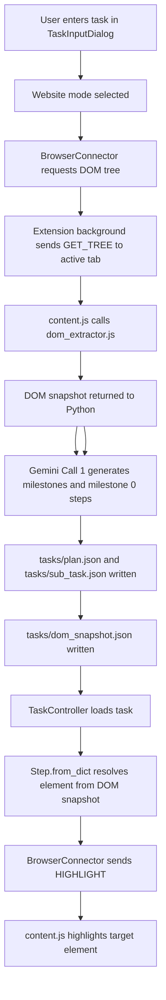
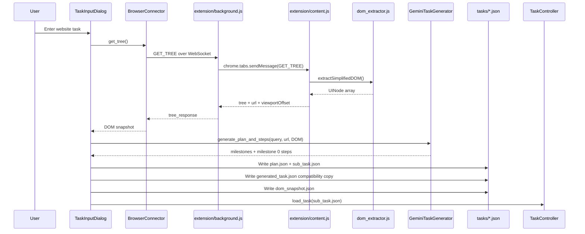
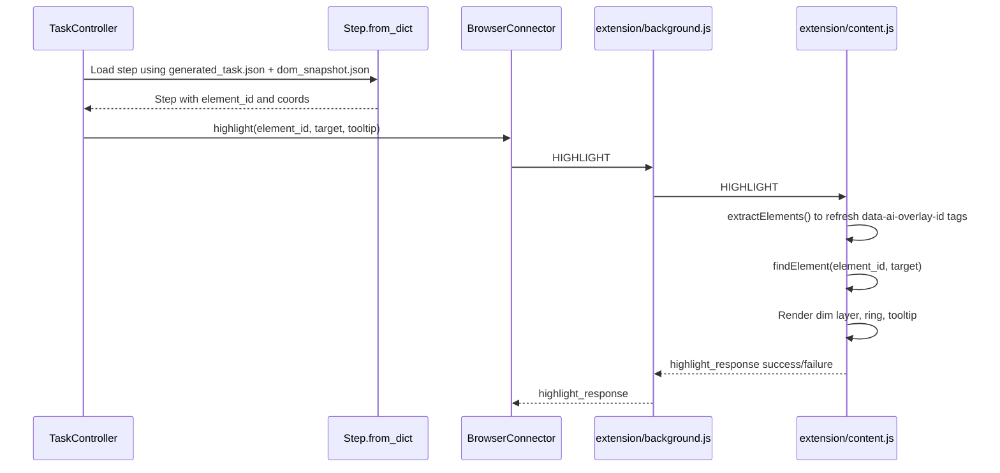
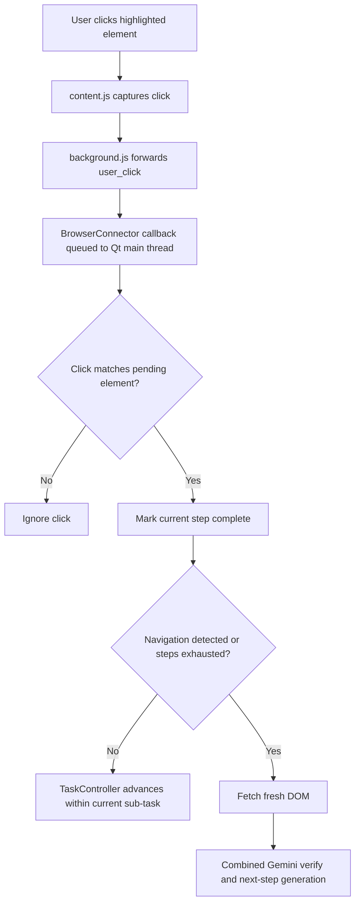
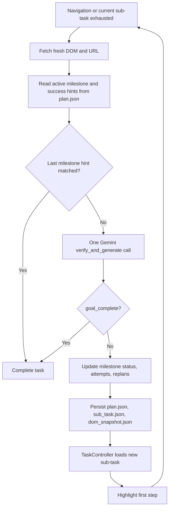
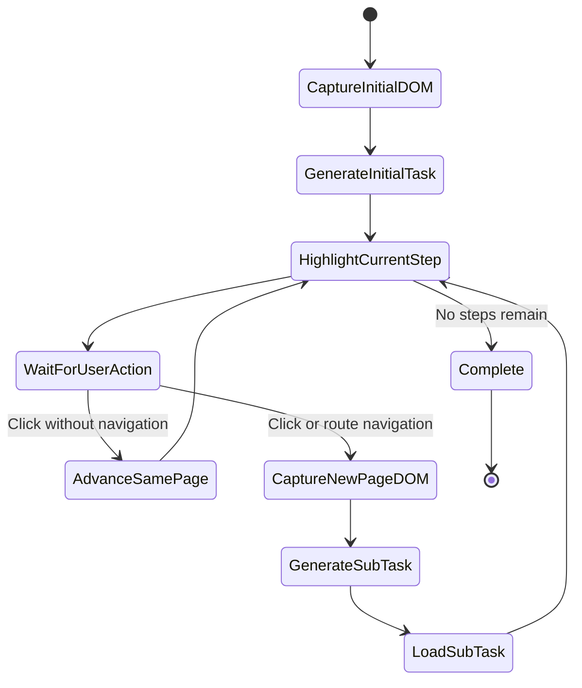

# Task Generation and Highlighting Architecture

This document describes the website-mode pipeline from the initial user request through DOM extraction, task generation, sub-task regeneration, and browser highlighting.

## High-level flow



## Main components

| Component | File | Responsibility |
|---|---|---|
| Task input UI | `core/UI.py` | Captures user query, target app/URL, fetches initial DOM, starts generation. |
| Task generator | `core/ai_task_generator.py` | Uses Gemini structured output for initial milestone plans, combined verification/step generation, and app-mode tasks. |
| Task model | `core/task.py` | Loads task JSON and DOM snapshot from disk. |
| Step model | `core/step.py` | Converts generated step JSON into runtime `Step` objects and resolves DOM element IDs/coords. |
| Controller | `core/task_controller.py` | Drives step progression and emits resolved steps. |
| Browser bridge | `platforms/browser_connector.py` | Runs WebSocket server on `ws://127.0.0.1:8765`; exchanges DOM, click, navigation, and highlight messages. |
| Extension background | `extension/background.js` | Maintains WebSocket client connection to Python and forwards messages to active browser tab. |
| Extension content script | `extension/content.js` | Handles DOM extraction requests, click events, navigation/mutation reporting, and page overlay rendering. |
| DOM extractor | `extension/dom_extractor.js` | Traverses the live page and returns simplified interactive/structural UI nodes. |

## Initial task generation



## Highlighting flow



### Important detail: element IDs are volatile

`dom_extractor.js` assigns `data-ai-overlay-id` values during each extraction. These IDs are not stable across page changes or repeated DOM traversal.

To reduce stale-ID errors, highlighting should validate that the element found by ID still matches the expected target text/type. If the ID points to the wrong element, `content.js` falls back to text/label matching.

## User click and navigation handling



## Multi-page sub-task generation loop

When the user follows a link or route change, the original `generated_task.json` may no longer match the current page. The runtime therefore generates a page-specific sub-task.



## Runtime files

| File | Purpose |
|---|---|
| `tasks/plan.json` | Persistent original goal, milestones, current index, attempt counts, and replan count. |
| `tasks/generated_task.json` | Compatibility copy of the initial website task; retained for existing tools. |
| `tasks/sub_task.json` | Current workflow steps for the active milestone/page. Rewritten at each verification point. |
| `tasks/dom_snapshot.json` | DOM snapshot used by `Task.load_from_file` to resolve step element IDs and bounds. Rewritten when a new page/sub-task is generated. |
| `tasks/history.json` | Recent task history used by the task input dialog. |

## Prompt context for sub-tasks

Each verification/generation call receives:

```text
Original user goal: <original query>
Full milestone plan and active milestone: <plan.json state>
Most recently completed step: <last completed target>
Current page URL: <browser URL>
Heuristic success-hint match: <boolean evidence>
Current page DOM: <fresh UINode JSON array>
```

The generator is instructed to:

- Continue the original goal.
- Generate only the next steps for the current page.
- Avoid repeating completed actions.
- Avoid navigating backward.

## Current failure points to watch

### Gemini API failure

Gemini API requests are retried once with backoff. If the retry also fails or returns malformed JSON, the current workflow is retained and a non-fatal recovery message is shown.

Relevant file:

```text
core/ai_task_generator.py
```

### Extension/WebSocket disconnect

The extension connects to Python at:

```text
ws://127.0.0.1:8765
```

A heartbeat in `extension/background.js` keeps the Manifest V3 service worker alive while Python waits for generation.

### DOM mutation loops

Overlay-created DOM mutations must not trigger repeated extraction/highlighting. `content.js` filters mutations involving overlay elements such as:

```text
#ai-overlay-dim
#ai-overlay-tooltip
#ai-overlay-spotlight-ring
#ai-overlay-progress-bar
#ai-overlay-style
```

## Simplified end-to-end loop


